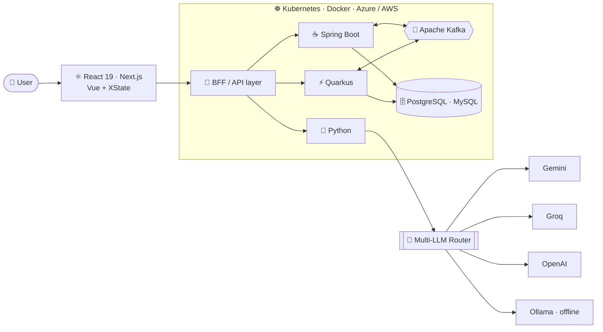

<div align="center">



<a href="https://github.com/Rahul-AlPHA1">
  
</a>

<br/>

[](https://rahul-alpha1.github.io/RahoolPortfolio.com/)
[](https://www.linkedin.com/in/rahool-goswami-4b055a126)
[](mailto:rahool.goswami16@gmail.com)
[](https://rahul-alpha1.github.io/rahul-alpha1/avatar-3d/)


</div>

<br/>

<table align="center">
<tr>
<td align="center" width="46%">
<a href="https://rahul-alpha1.github.io/rahul-alpha1/avatar-3d/">
  
</a>
<br/>
<sub>🕹️ <b><a href="https://rahul-alpha1.github.io/rahul-alpha1/avatar-3d/">Click me</a></b> — the 3D version follows your cursor 👀</sub>
</td>
<td align="center" width="54%">

</td>
</tr>
</table>

---

## 👨‍💻 About Me

```java
public class RahoolGir extends SoftwareEngineer implements AIProductBuilder, TeamLead {

    String   title      = "Senior Full-Stack Software Engineer";
    String   now        = "Senior Consultant @ Systems Limited — Confiz (SL Americas)";
    String   project    = "Chatterbox — AI-enabled US healthcare application";
    String   before     = "4 yrs @ TereSol → AL-Habib Bank Core Banking (led a 4-engineer team)";
    String   location   = "Karachi, Pakistan 🇵🇰  · Remote-ready with US/EU overlap 🌍";
    String   certified  = "micro1 — Senior Software Design Engineer (system design)";

    String[] backend    = { "Java", "Spring Boot", "Quarkus", "Python", "Node.js", "Kafka" };
    String[] frontend   = { "React 19", "Next.js", "TypeScript", "Vue.js + XState" };
    String[] cloud      = { "Azure", "AWS", "Docker", "Kubernetes", "GitHub Actions" };
    String[] ai         = { "Gemini", "Groq", "OpenAI", "Ollama", "RAG", "Multi-LLM routing" };

    String[] superpowers = {
        "Tracing a bug from the browser → BFF → services → Kafka → DB → k8s",
        "Ramping onto huge unfamiliar codebases before touching a line",
        "Reviewing AI-generated code like it's going to production — because it is"
    };

    String funFact = "Most FYPs die on submission day. Mine became a product. 🛡️";
}
```

---

## 🏢 Experience

<table>
<tr>
<td width="26%" align="center">


</td>
<td width="74%">

### 🏥 Senior Consultant — Application Development (Java Full-Stack)
**Project: Chatterbox** — an AI-enabled application for a US healthcare client

- ⚡ Full-stack features across **Java/Spring Boot + Python** services and **React, Next.js & Vite** front-ends
- 🔎 Build & debug UI for the **AI Search** and **Tech AI** modules — loading, error and state edge cases for AI responses
- 🧭 Onboarded onto an existing **BFF** codebase — mapped request flows, API contracts and downstream dependencies first
- 🚢 Ship through **Azure, Docker & CI/CD** in Agile sprints with a distributed onshore/offshore team

`Java` `Spring Boot` `Python` `React` `Next.js` `Vite` `BFF` `Azure` `Docker` `CI/CD`

</td>
</tr>
<tr>
<td width="26%" align="center">


</td>
<td width="74%">

### 🏦 Senior Software Design Engineer — Core Banking Platform

- 👥 **Led a 4-member team** — mentoring, code reviews, architecture, estimation & sprint planning
- 🧩 REST APIs across **10+ distributed microservices** with **Java, Spring Boot & Quarkus**, **Kafka** events, **Kubernetes** orchestration
- 🌐 Architected **4+ Trade Finance** import/export modules — thousands of daily cross-border transactions under **SBP regulations**
- 💳 Delivered **3 Teller Module** capabilities (outward bill clearing, credit-card fund transfers) used in branches nationwide
- ⏱️ Automated transaction reconciliation — daily financial close from **hours → minutes**
- 🖥️ Owned **Vue.js + XState** front-ends for complex banking state machines

`Java` `Spring Boot` `Quarkus` `JPA/Hibernate` `Kafka` `Kubernetes` `Docker` `Vue.js` `XState` `MySQL` `AWS` `JUnit` `Mockito`

</td>
</tr>
</table>

<details>
<summary>📜 <b>Earlier roles</b></summary>
<br/>

- **Web Design Intern** — Abtach Pvt. Ltd. *(Jun – Aug 2021)* · 10+ responsive interfaces from Figma
- **C# Developer Trainee** — Media Monitors *(Jan – May 2021)* · 5+ ASP.NET MVC modules, ~30% faster report generation

</details>

---

## 🧬 How I Build Systems



---

## 🚀 Featured Projects

<table>
<tr>
<td width="50%" valign="top">

### 🛡️ FakeShield
**Multimodal misinformation & deepfake detector**

Text · URL · image · audio · video analysis with risk scores and AI reasoning. Grew from my FYP (LSTM/CNN on **40,000+ articles, 92%+ accuracy**) into a full product with voice-clone & image-deepfake detection.

`React 19` `TypeScript` `Node/Express` `Python` `Gemini` `Groq` `Ollama`

[](https://fake-shield-all-in-one-fake-news-de.vercel.app/)
[](https://github.com/Rahul-AlPHA1/FakeShield-All-in-One-Fake-News-Deepfake-Detector)

</td>
<td width="50%" valign="top">

### 🧠 Zynapse AI Engineering Academy
**AI learning OS — web + Windows desktop app**

Roadmaps, AI-generated lessons, interview Q&A, quizzes, code review, study planner and PDF export. Routes across **Groq, Gemini & OpenAI** with an **offline Ollama / Gemma 2B** fallback — no API key needed.

`React 19` `TypeScript` `Express` `Electron` `NSIS` `Ollama`

[](https://zynapse-ai-engineering-academy.vercel.app/)
[](https://github.com/Rahul-AlPHA1/Zynapse-AI-Engineering-Academy)

</td>
</tr>
<tr>
<td width="50%" valign="top">

### 💰 LendLedger
**Full-stack AI financial ledger**

Spring Boot REST API on PostgreSQL/MySQL with a typed React client and Recharts dashboards. Gemini writes payment reminders, monthly summaries and risk assessments; one-click PDF statements.

`Java` `Spring Boot` `JPA/Hibernate` `PostgreSQL` `React 19` `Gemini`

[](https://lend-ledger-one.vercel.app/)
[](https://github.com/Rahul-AlPHA1/LendLedger)

</td>
<td width="50%" valign="top">

### 🎯 InterView Alpha
**AI technical interview platform**

Role-specific mock interviews, local RAG knowledge base, resume-to-JD matching from PDFs, and an AI code pad with live Big-O analysis. Switches between Groq, OpenAI and Gemini.

`React` `TypeScript` `Vite` `RAG` `PDF.js` `Multi-LLM`

[](https://interview-alpha-7b9szo785-rahul-alpha1s-projects.vercel.app/)
[](https://github.com/Rahul-AlPHA1/interview-alpha-pro)

</td>
</tr>
</table>

---

## 🛠️ Tech Arsenal

<div align="center">

**Languages & Backend**<br/>


**Frontend & Desktop**<br/>


**Data, Messaging & Cloud**<br/>


**AI / LLM**<br/>


**Testing & Daily AI Drivers**<br/>


</div>

---

## 📊 GitHub Stats

<div align="center">


<br/><br/>

<picture>
  <source media="(prefers-color-scheme: dark)" srcset="https://raw.githubusercontent.com/Rahul-AlPHA1/rahul-alpha1/output/github-snake-dark.svg"/>
  <source media="(prefers-color-scheme: light)" srcset="https://raw.githubusercontent.com/Rahul-AlPHA1/rahul-alpha1/output/github-snake.svg"/>
  
</picture>

</div>

---

## 💭 What Drives Me

<table>
<tr>
<td align="center" width="33%">

### 🚢 Ship It
Real users beat perfect code. Every weekend = one more feature live.

</td>
<td align="center" width="33%">

### 🏦 Code Touches Money
Banking taught me: no shortcuts on correctness, security or traceability.

</td>
<td align="center" width="33%">

### 🌍 AI for Everyone
The best AI tools should run on a ₨30,000 laptop with no internet.

</td>
</tr>
</table>

---

## 🏆 Certifications & 🎓 Education

<div align="center">

| 🏅 Certification | 🏢 Issuer | 📅 |
|:---|:---|:---:|
| **Senior Software Design Engineer** — system design & distributed architecture |  | Apr 2026 |
| **Java & Data Structures and Algorithms** |  | 2024 – 25 |
| **SQL (Advanced)** · **Problem Solving (Intermediate)** |  | 2024 |

**🏛️ B.Sc. Computer Science — Sindh Madressatul Islam University (SMIU), Karachi · 2018 – 2022**<br/>
<sub>FYP: Fake News Detector (LSTM/CNN · 40K+ articles · 92%+ accuracy) → evolved into <b>FakeShield</b></sub>

</div>

---

## 📬 Let's Build Something

<div align="center">

**Open to remote roles with US / EU overlap** — full-stack, backend, fintech or AI product work.

[](https://www.linkedin.com/in/rahool-goswami-4b055a126)
[](mailto:rahool.goswami16@gmail.com)
[](https://rahul-alpha1.github.io/RahoolPortfolio.com/)

<br/><br/>


</div>
